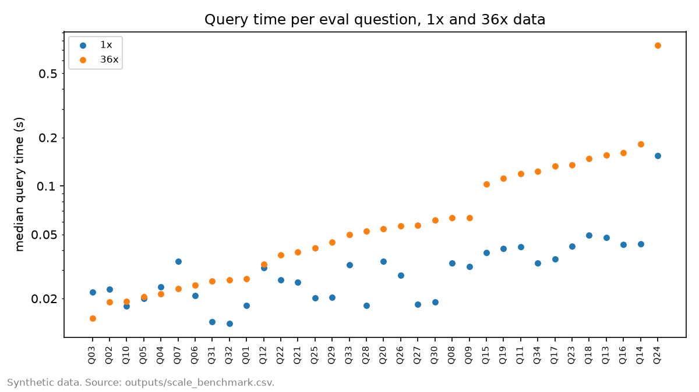
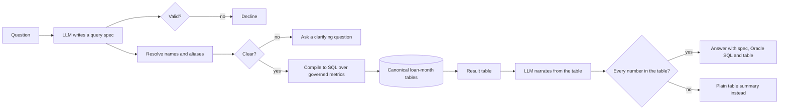
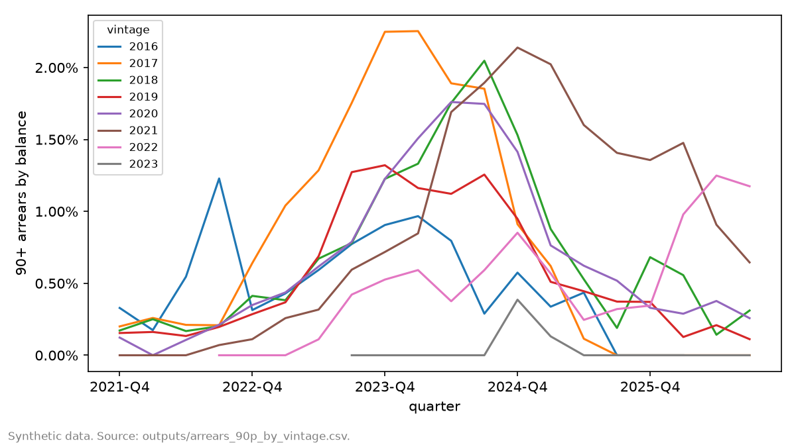

# RMBS Natural Language Query

Ask questions of loan-level RMBS data in plain English, and get numbers you can check. A language model turns each question into a small JSON query spec. A compiler turns the spec into SQL over governed metric definitions, so the model never does the arithmetic. Every answer comes with its spec, its Oracle SQL and the table it came from, and a guard rejects any narrated number that isn't in that table.

All data in this repo is synthetic: 50 Australian RMBS deals, 21,945 loans and 773,336 loan-months from 2021-10 to 2026-09, delivered in 2 trustee formats with the inconsistencies real trustee data has. The reasoning behind the design is in [docs/DESIGN_RESPONSE.md](docs/DESIGN_RESPONSE.md).

## Results

**The live eval hasn't been recorded in this copy.** It compares the governed system with a model writing SQL directly, on 40 questions. It needs an Anthropic API key, which is never stored in the repo. With your own key, in PowerShell from the repo root:

    $env:ANTHROPIC_API_KEY = "<your key>"
    python scripts/run_eval.py --mode record
    python scripts/build_writeup.py

The first command records about 114 API calls into `data/llm_cache/`. The second regenerates this README, the design response, the figures and the PDFs from the results. After that, everything replays offline with no key.

**Cleaning, proved row for row.** The raw trustee files hold 774,057 rows, including 721 resubmitted duplicates. Format B codes its 7 clean-up calls as ordinary repayments. The canonical table rebuilt from those files matches the simulated truth on all 773,336 loan-months, with 0 mismatches.

**Compiler, checked against hand-written SQL.** 49 of 49 hand-written queries match the compiler, and the worst difference is 1.6e-15. All 49 render to Oracle without a construct Oracle can't run.

**Scale.** Copied 36 times to 27,840,096 loan-months, all 34 answerable eval questions run in under 0.75 seconds each with DuckDB's default threads; the slowest single-threaded run takes 3.34 seconds.



## How it works



## The data

The synthetic pool follows the RBA cash rate from 2016 and suburb house price indices, with interest-only and fixed-rate expiries, lenders mortgage insurance and hardship arrangements. 90+ arrears by balance rise from 0.18% to a peak of 1.54% in 2024-08, then ease to 0.47%.



The 2 trustee formats differ in arrears units (days against missed payments), hardship coding, how clean-up calls are reported, and money units. A few months are resubmitted on top of the originals. The canonical layer in `rmbsq/canonical/` undoes all of it.

## Limitations

- The data is synthetic. It is built to carry real traps, not to forecast real deals.
- The eval is 40 questions, run once at temperature 0. Each category holds at most 10 questions, so intervals are wide, and repeat-run stability isn't measured.
- Oracle SQL is rendered and checked for constructs Oracle can't run, but not executed against Oracle. The timings are DuckDB timings on 1 machine.

## Running it

```bash
uv venv --python 3.12 .venv
uv pip sync --python .venv requirements-lock.txt
uv pip install --python .venv -e . --no-deps
python scripts/build_canonical.py --raw data/raw --db data/canonical/rmbs.duckdb
rmbsq ask "What is the 90+ arrears rate by balance for each state now?" --show-sql
pytest -q && pytest -q -m full
```

`rmbsq ask` replays from the recorded cache. Add `--live` and set `ANTHROPIC_API_KEY` to ask new questions.

## Repo map

| path | what it holds |
|---|---|
| `rmbsq/synth/` | the synthetic data generator |
| `rmbsq/canonical/` | trustee file ingestion and cleaning |
| `rmbsq/semantic/` | metric catalogue, query spec and compiler |
| `rmbsq/llm/` | prompts, cache, name resolution, narration and number guard |
| `rmbsq/eval/` | eval runner, scoring and scale benchmark |
| `eval/questions.yaml` | the 40 eval questions, with gold specs and SQL |
| `outputs/` | every committed result, as CSV, plus figures |
| `deliverable/` | the 2 PDFs |
| `instructions/`, `review/` | how the repo was built, section by section, and the evidence for each |
