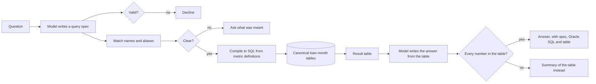

# RMBS Natural Language Query

Ask questions of loan-level RMBS data in ordinary language, and get answers you can verify. A language model converts each question into a structured query spec, and a compiler turns the spec into SQL using metric definitions held in code, so the model never does the arithmetic. Each answer comes with its spec, its Oracle SQL and its result table, and any number in the answer text that isn't in the table is rejected.

All data here is synthetic, covering 50 Australian RMBS deals, 21,945 loans and 773,336 loan-months from 2021-10 to 2026-09, in 2 trustee formats with the inconsistencies real trustee data has. The reasoning behind the design is in [docs/DESIGN_RESPONSE.md](docs/DESIGN_RESPONSE.md).

## Results

**Compared with direct SQL, on 40 questions.** On the 34 questions with a numeric answer, a model writing SQL directly got 33 right and the compiled approach 31. Neither returned an incorrect number (0 and 0), so every miss on both sides was a refusal to answer.

- The compiled approach didn't recognise "Queensland", and asked for a day threshold on questions phrased in missed payments.
- Direct SQL declined all 4 ambiguous questions, where the compiled approach asked what was meant.

Overall, the compiled approach got 37 of 40 (92.5%, 95% interval 80.1% to 97.4%) and direct SQL 35 of 40 (87.5%, interval 73.9% to 94.5%). The direct SQL prompt contained the full metric definitions and the exact output columns, so this compares 2 ways of applying the same definitions, not definitions against none. The design response discusses what that means.

| category | questions | compiled approach | direct SQL |
|---|---|---|---|
| simple | 10 | 9 (90%) | 10 (100%) |
| grouped | 10 | 10 (100%) | 10 (100%) |
| time | 6 | 6 (100%) | 6 (100%) |
| trap | 8 | 6 (75%) | 7 (88%) |
| ambiguous | 4 | 4 (100%) | 0 (0%) |
| unsupported | 2 | 2 (100%) | 2 (100%) |
| total | 40 | 37 (92%) | 35 (88%) |


**Cleaning, tested row by row.** The raw trustee files hold 774,057 rows, including 721 resubmitted duplicates, and format B reports its 7 clean-up calls as ordinary repayments. The canonical table rebuilt from those files matches the simulated truth on all 773,336 loan-months, with 0 differences.

**Compiler, tested against hand-written SQL.** 49 of 49 hand-written queries match the compiler's output, with a worst difference of 1.6e-15. All 49 render to Oracle using only supported constructs.

**Volume.** With the data copied 36 times to 27,840,096 loan-months, each of the 34 questions with a numeric answer runs in under 0.75 seconds with DuckDB's default threads. The slowest single-threaded run takes 3.34 seconds.


## How it works



## The data

The synthetic pool follows the RBA cash rate from 2016 and suburb house price indices, with interest only and fixed rate expiries, lenders mortgage insurance and hardship arrangements. 90+ arrears by balance rise from 0.18% to a peak of 1.54% in 2024-08, then fall back to 0.47%.


The 2 trustee formats differ in how they report arrears (days or missed payments), hardship, clean-up calls and money amounts, and some months are resubmitted on top of the originals. The canonical layer in `rmbsq/canonical/` reconciles all of it.

## Limitations

- The data is synthetic. It is built to reproduce real data problems, not to model real deals.
- The test set is 40 questions, run once. Each category holds at most 10 questions, so the intervals are wide. Current Claude models don't accept a sampling temperature, so a rerun could give different answers, and I haven't measured how much they vary. The recorded responses make this particular run reproducible.
- The Oracle SQL is generated and checked for unsupported constructs, but hasn't been run on Oracle. The timings are DuckDB timings on 1 machine.

## Running it

```bash
uv venv --python 3.12 .venv
uv pip sync --python .venv requirements-lock.txt
uv pip install --python .venv -e . --no-deps
python scripts/build_canonical.py --raw data/raw --db data/canonical/rmbs.duckdb
rmbsq ask "What is the 90+ arrears rate by balance for each state now?" --show-sql
pytest -q && pytest -q -m full
```

`rmbsq ask` replays recorded responses. Add `--live` and set `ANTHROPIC_API_KEY` to ask new questions.

## Repo map

| path | contents |
|---|---|
| `rmbsq/synth/` | synthetic data generator |
| `rmbsq/canonical/` | trustee file loading and cleaning |
| `rmbsq/semantic/` | metric definitions, query spec and compiler |
| `rmbsq/llm/` | prompts, response cache, name matching, answer writing and the number check |
| `rmbsq/eval/` | test set runner, scoring and scale benchmark |
| `eval/questions.yaml` | the 40 test questions, with expected specs and SQL |
| `outputs/` | every committed result, as CSV, plus figures |
| `deliverable/` | the 2 PDFs |
| `instructions/`, `review/` | how the repo was built, section by section, with the evidence for each |
