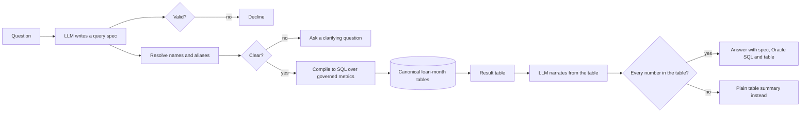

# Review: Section 6, repo write-up

Follow this template exactly. Every number below must be backed by raw rows or raw
output printed in full in this file (CLAUDE.md rule 10). No paraphrased results.

## 1. Outcome

- Instruction file: `instructions/06_section_6.md`
- Outcome: complete
- Last step reached: 6.6
- Stop reason (if stopped): none. The eval stays unrecorded, as instruction 06 A says.
  The write-up is committed in the pending state. The recorded state is proved by
  `test_recorded_state_renders` on a constructed `eval_summary.csv` (K.4 below).
- No API call was made in this session.

## 2. Commits

Output of `git log --oneline` for this section's commits, oldest last, pasted verbatim.

```
c8938d7 step 6.6: PLAN.md Section 6 updated for instruction 06, with the pending and recorded states and the new outputs
4814311 step 6.5: CI runs the suite and the full-profile tests on push and pull request to main
11fdf2d step 6.4: build_writeup renders the README and design response in the pending state, with claims, figures and the worked example
2e16a6e step 6.3: figures from committed CSVs, the arrears by vintage CSV through compile, the worked example and replayed transcripts
03aab31 step 6.2: claims built from the summary CSVs, with the eval claims in the recorded state only
629fe6b step 6.1: data summary, compiler check and trap effects, with the truth comparison moved into rmbsq/canonical/truth_check.py
7e37625 step 6.0: templates copied, fixed_numbers.txt, render and the number check
```

Steps 6.0 to 6.5 were pushed together after the 6.5 commit, because step 6.5 needs a
push to run CI. Step 6.6 was pushed with this review.

## 3. Steps

Unless a block says otherwise, every number comes from the full canonical database
(`data/canonical/rmbs.duckdb`), built from the committed `data/raw/`.

### Step 6.0: templates and render

- Files: `templates/README.md.tmpl`, `templates/DESIGN_RESPONSE.md.tmpl` (byte copies),
  `templates/fixed_numbers.txt`, `rmbsq/deliverable/render.py`,
  `rmbsq/deliverable/numbers.py`, `tests/test_render.py`, `tests/test_numbers.py`
- Signatures implemented: `render(template_text, claims: dict, blocks: dict,
  eval_recorded: bool) -> str`; `unexplained_numbers(rendered, claims, blocks, fixed) ->
  list[str]`
- Tests: `test_render_sections`, `test_number_check`, result passed
- Outputs: none
- Evidence:

```
$ cmp templates/README.md.tmpl instructions/06_templates/README.md.tmpl && echo same
same
$ cmp templates/DESIGN_RESPONSE.md.tmpl instructions/06_templates/DESIGN_RESPONSE.md.tmpl && echo same
same
$ cat templates/fixed_numbers.txt
0
1
2
3
4
5
6
8
10
21
-1
30
34
36
40
90
95%
114
300
2000
3.12
$ pytest -v tests/test_render.py tests/test_numbers.py
tests/test_render.py::test_render_sections PASSED                        [ 50%]
tests/test_numbers.py::test_number_check PASSED                          [100%]
============================== 2 passed in 0.10s ==============================
```

- Deviations:
  - `render.py` also has `resolve_sections` and `names_used(template_text,
    eval_recorded)`. `names_used` lists the placeholders left once the sections are
    resolved. The callers use it to pass `unexplained_numbers` only the claims a
    document uses, which is how B defines the allowed set.
  - `unexplained_numbers` takes the deal names from `build_deals` for the full profile,
    which makes no random draws. That gives the same 50 names as `dim_deal`, and the
    check needs no database.
  - An unknown section name, or a stray or nested section marker, also raises.

### Step 6.1: summary outputs

- Files: `scripts/build_summary.py`, `rmbsq/eval/summary.py`, `rmbsq/eval/traps.py`,
  `rmbsq/canonical/truth_check.py`, `tests/test_summary.py`, and
  `tests/test_canonical_truth.py`, changed to call the moved comparison
- Signatures implemented: `data_summary(db, raw_dir, pool_monthly_csv, panel, cfg)`,
  `compiler_check(db, gold, items, catalog)`, `max_scaled_diff(got, want, metrics)`,
  `oracle_ok(sql_oracle)`, `trap_effects(con, catalog)`, `truth_check(db, panel) ->
  TruthCheck`
- Tests: `test_data_summary_values`, `test_compiler_check`, `test_trap_effects` (all
  `full`), and `test_canonical_equals_truth_panel` with its full twin, result passed
- Outputs: `outputs/data_summary.csv` (12 rows), `outputs/compiler_check.csv` (49 rows),
  `outputs/trap_effects.csv` (6 rows). All 3 are printed in full in K.1.
- Evidence: the 3 CSVs (K.1). The C.3 values compared with chat Claude's, to 1e-4:

```
item     gold (CSV)     chat Claude   naive (CSV)    chat Claude
Q27      0.0066313916   0.006631      0.0058570250   0.005857
Q29      0.2155508154   0.2156        1.0000000000   1.0000
Q30      0.1831651907   0.1832        0.4898374471   0.4898
Q32      9975           9975          10572          10572
Q33      0.5196431995   0.519643      0.5091750448   0.509175
Q2_2025  0.1806444857   0.180644      0.1806323390   0.180632
$ pytest -v tests/test_summary.py tests/test_canonical_truth.py -m full
tests/test_summary.py::test_data_summary_values PASSED                   [ 25%]
tests/test_summary.py::test_compiler_check PASSED                        [ 50%]
tests/test_summary.py::test_trap_effects PASSED                          [ 75%]
tests/test_canonical_truth.py::test_full_canonical_equals_truth_panel PASSED [100%]
====================== 4 passed, 1 deselected in 16.65s =======================
```

- Deviations:
  - The comparison in `test_canonical_truth.py` moved into `truth_check.py`, as C.1
    says. The test now asserts the same things through it: equal row counts, every row
    matched, and 0 mismatches per column. A NaN float difference counts as a mismatch,
    as the old `diff.max() <= 1e-9` assertion did. The new count of mismatched rows is
    the C.1 stat.
  - The compiler gold specs are read from `tests/fixtures/compiler_gold.json`. It is
    byte-identical to `instructions/04_compiler_gold.json`, and it is the file the step
    3.3 test uses.
  - The step 3.3 rule and the step 3.5 banned list are now also in
    `rmbsq/eval/summary.py`. The test copies in `tests/test_compiler.py` and
    `tests/test_oracle_render.py` are unchanged (rule 5).
  - In `trap_effects.csv`, Q32's gold and naive are loan counts. They are written as
    integers, not `%.10f`.
  - The naive CPR SQL skips `LN(1 - m)` for a month with m >= 1, as the B.6 compiler does.
    The CASE then returns 1 whenever any m >= 1. This is what makes Q29's naive value
    1.0000.

### Step 6.2: claims

- Files: `rmbsq/deliverable/claims.py`, `tests/test_claims.py`
- Signatures implemented: `build_claims(eval_recorded: bool, outputs=OUTPUTS,
  out=CLAIMS_CSV) -> pd.DataFrame`
- Tests: `test_claims_pending`, result passed
- Outputs: `deliverable/claims.csv` (28 claims, pending state), committed in step 6.4
  and printed in full in K.2
- Evidence:

```
$ pytest -v tests/test_claims.py
tests/test_claims.py::test_claims_pending PASSED                         [100%]
============================== 1 passed in 0.30s ==============================
```

- Deviations:
  - `build_claims` takes 2 extra keyword arguments with defaults: `outputs`, the folder
    the source CSVs are read from, and `out`, the CSV written (None writes nothing). The
    recorded-state test uses them on a temp folder.
  - `value` holds floats in full (Python `repr`), so `gold_worst_diff` (1.61e-15) and
    `trap_compound_gap` aren't flattened to 0 by `%.10f`.
  - For `x36_max_default_s`, `value` is the raw maximum (0.745008) and `display` is it
    rounded up to 2 dp (0.75), by D.
  - The `pp1` format is not implemented, because no claim in D uses it. Its display string
    is not fully specified (O-44).
  - The test recomputes every value from its source CSV with independent pandas code,
    and also checks 6 display strings.

### Step 6.3: figures and worked example

- Files: `scripts/make_figures.py`, `rmbsq/deliverable/figures.py`,
  `rmbsq/deliverable/examples.py`, `tests/test_figures.py`,
  `outputs/arrears_90p_by_vintage.csv`
- Signatures implemented: `build_arrears_by_vintage(db, outputs)`,
  `make_figures(outputs, eval_recorded)`, `worked_example(items, db, outputs)`,
  `transcripts(items, db, outputs, cache_dir, cfg, eval_recorded)`
- Tests: `test_figures_deterministic`, result passed
- Outputs: `outputs/arrears_90p_by_vintage.csv` (148 rows),
  `outputs/figures/arrears_90p_by_vintage.png`, `outputs/figures/scale_benchmark.png`,
  and `outputs/worked_example.md`. The figures and the worked example are committed in
  6.4. There is no `eval_accuracy.png` and no `outputs/transcripts/`.
- Evidence: the figures (K.5); the worked example in full:

````
# Worked example: the compiler path (spec written by hand)

## Question

Show the 90+ arrears rate by balance for each state at the latest month.

## Spec

```json
{
  "intent": "answer",
  "metrics": [
    "arrears_90p_bal"
  ],
  "group_by": [
    "state"
  ],
  "filters": {},
  "time": {
    "grain": "month",
    "start": "2026-09",
    "end": "2026-09",
    "shape": "point"
  },
  "order": null,
  "clarify": null,
  "unsupported_reason": null
}
```

## Oracle SQL

```sql
WITH parts AS (
  SELECT
    l.state AS state,
    f.period,
    SUM(CASE WHEN f.closing_balance > 0 THEN 1 ELSE 0 END) AS loan_count,
    SUM(CASE WHEN f.closing_balance > 0 THEN f.closing_balance ELSE 0 END) AS bal,
    SUM(
      CASE
        WHEN f.closing_balance > 0 AND f.dpd_bucket >= 2 AND NOT f.hardship_flag
        THEN f.closing_balance
        ELSE 0
      END
    ) AS a30_bal,
    SUM(
      CASE
        WHEN f.closing_balance > 0 AND f.dpd_bucket = 4 AND NOT f.hardship_flag
        THEN f.closing_balance
        ELSE 0
      END
    ) AS a90_bal,
    SUM(
      CASE
        WHEN f.closing_balance > 0 AND f.dpd_bucket = 4 AND NOT f.hardship_flag
        THEN 1
        ELSE 0
      END
    ) AS a90_cnt,
    SUM(
      CASE
        WHEN f.closing_balance > 0 AND f.hardship_flag
        THEN f.closing_balance
        ELSE 0
      END
    ) AS hard_bal,
    SUM(
      CASE
        WHEN f.closing_balance > 0
        THEN CAST(f.closing_balance AS DOUBLE PRECISION) * l.orig_ltv
        ELSE 0
      END
    ) AS orig_ltv_x_bal,
    SUM(
      CASE
        WHEN f.closing_balance > 0
        THEN CAST(f.closing_balance AS DOUBLE PRECISION) * f.indexed_ltv
        ELSE 0
      END
    ) AS idx_ltv_x_bal,
    SUM(
      CASE
        WHEN f.closing_balance > 0
        THEN CAST(f.closing_balance AS DOUBLE PRECISION) * f.interest_rate
        ELSE 0
      END
    ) AS rate_x_bal,
    SUM(CASE WHEN f.opening_balance > 0 THEN f.curtailment ELSE 0 END) + SUM(
      CASE
        WHEN f.opening_balance > 0 AND f.exit_reason = 'prepaid'
        THEN f.exit_balance
        ELSE 0
      END
    ) AS smm_num,
    SUM(
      CASE
        WHEN f.opening_balance > 0
        AND (
          f.exit_reason IS NULL OR f.exit_reason = 'prepaid'
        )
        THEN f.opening_balance - f.scheduled_principal
        ELSE 0
      END
    ) AS smm_den,
    SUM(
      CASE
        WHEN f.opening_balance > 0 AND f.exit_reason = 'defaulted'
        THEN f.exit_balance
        ELSE 0
      END
    ) AS mdr_num,
    SUM(CASE WHEN f.opening_balance > 0 THEN f.opening_balance ELSE 0 END) AS mdr_den
  FROM fact_loan_month f
  JOIN dim_loan l
    ON l.loan_id = f.loan_id
  JOIN dim_deal d
    ON d.deal_id = f.deal_id
  WHERE
    f.period BETWEEN TO_DATE('2026-09-01', 'YYYY-MM-DD') AND TO_DATE('2026-09-01', 'YYYY-MM-DD')
  GROUP BY
    l.state,
    f.period
), b AS (
  SELECT
    parts.*,
    '2026-09' AS period_label
  FROM parts
), keys AS (
  SELECT DISTINCT
    state,
    period_label
  FROM b
), stock AS (
  SELECT
    state,
    period_label,
    CAST(a90_bal AS DOUBLE PRECISION) / CAST(bal AS DOUBLE PRECISION) AS arrears_90p_bal
  FROM (
    SELECT
      b.*,
      ROW_NUMBER() OVER (PARTITION BY state, period_label ORDER BY period DESC NULLS LAST) AS rn
    FROM b
    WHERE
      loan_count > 0
  ) r
  WHERE
    rn = 1
)
SELECT
  k.state,
  k.period_label,
  s.arrears_90p_bal
FROM keys k
LEFT JOIN stock s
  ON s.state = k.state AND s.period_label = k.period_label
ORDER BY
  k.state,
  k.period_label
```

## Result

| state | period_label | arrears_90p_bal |
|---|---|---|
| NSW | 2026-09 | 0.55% |
| QLD | 2026-09 | 0.34% |
| SA | 2026-09 | 0.19% |
| VIC | 2026-09 | 0.35% |
| WA | 2026-09 | 0.91% |
````

The arrears figure's source CSV, in full:

```
vintage_year,period_label,arrears_90p_bal
2016,2021-Q4,0.0032885250
2016,2022-Q1,0.0017475465
2016,2022-Q2,0.0054607994
2016,2022-Q3,0.0122867662
2016,2022-Q4,0.0031397847
2016,2023-Q1,0.0042970072
2016,2023-Q2,0.0059272090
2016,2023-Q3,0.0077314935
2016,2023-Q4,0.0090527871
2016,2024-Q1,0.0096703013
2016,2024-Q2,0.0079524439
2016,2024-Q3,0.0028911866
2016,2024-Q4,0.0057429368
2016,2025-Q1,0.0033758057
2016,2025-Q2,0.0043516164
2016,2025-Q3,0.0000000000
2016,2025-Q4,0.0000000000
2016,2026-Q1,0.0000000000
2017,2021-Q4,0.0020027928
2017,2022-Q1,0.0025907245
2017,2022-Q2,0.0021105779
2017,2022-Q3,0.0020850417
2017,2022-Q4,0.0064044801
2017,2023-Q1,0.0104076772
2017,2023-Q2,0.0128564635
2017,2023-Q3,0.0175421585
2017,2023-Q4,0.0224854614
2017,2024-Q1,0.0225330430
2017,2024-Q2,0.0189043783
2017,2024-Q3,0.0185278524
2017,2024-Q4,0.0091096071
2017,2025-Q1,0.0062033120
2017,2025-Q2,0.0011478996
2017,2025-Q3,0.0000000000
2017,2025-Q4,0.0000000000
2017,2026-Q1,0.0000000000
2017,2026-Q2,0.0000000000
2017,2026-Q3,0.0000000000
2018,2021-Q4,0.0017206186
2018,2022-Q1,0.0025054426
2018,2022-Q2,0.0016805010
2018,2022-Q3,0.0020143658
2018,2022-Q4,0.0041271228
2018,2023-Q1,0.0038267174
2018,2023-Q2,0.0067144185
2018,2023-Q3,0.0077991764
2018,2023-Q4,0.0122632311
2018,2024-Q1,0.0133151148
2018,2024-Q2,0.0175443641
2018,2024-Q3,0.0204721561
2018,2024-Q4,0.0153098348
2018,2025-Q1,0.0087764381
2018,2025-Q2,0.0052829186
2018,2025-Q3,0.0018982075
2018,2025-Q4,0.0068177429
2018,2026-Q1,0.0055679364
2018,2026-Q2,0.0014264846
2018,2026-Q3,0.0031104505
2019,2021-Q4,0.0015444989
2019,2022-Q1,0.0016183512
2019,2022-Q2,0.0013384562
2019,2022-Q3,0.0019693043
2019,2022-Q4,0.0028549470
2019,2023-Q1,0.0036815178
2019,2023-Q2,0.0068808632
2019,2023-Q3,0.0127281487
2019,2023-Q4,0.0132085018
2019,2024-Q1,0.0116246099
2019,2024-Q2,0.0112212360
2019,2024-Q3,0.0125582432
2019,2024-Q4,0.0094833325
2019,2025-Q1,0.0051039692
2019,2025-Q2,0.0044506278
2019,2025-Q3,0.0037294091
2019,2025-Q4,0.0037085456
2019,2026-Q1,0.0012685671
2019,2026-Q2,0.0020908080
2019,2026-Q3,0.0011177303
2020,2021-Q4,0.0012284778
2020,2022-Q1,0.0000000000
2020,2022-Q2,0.0010647989
2020,2022-Q3,0.0021214488
2020,2022-Q4,0.0034898770
2020,2023-Q1,0.0043673624
2020,2023-Q2,0.0061670613
2020,2023-Q3,0.0078804492
2020,2023-Q4,0.0122570783
2020,2024-Q1,0.0150796101
2020,2024-Q2,0.0176043186
2020,2024-Q3,0.0174727528
2020,2024-Q4,0.0141369957
2020,2025-Q1,0.0076358835
2020,2025-Q2,0.0062239590
2020,2025-Q3,0.0051843878
2020,2025-Q4,0.0032970558
2020,2026-Q1,0.0028868278
2020,2026-Q2,0.0037726217
2020,2026-Q3,0.0025773950
2021,2021-Q4,0.0000000000
2021,2022-Q1,0.0000000000
2021,2022-Q2,0.0000000000
2021,2022-Q3,0.0007074432
2021,2022-Q4,0.0011159119
2021,2023-Q1,0.0025807782
2021,2023-Q2,0.0031738372
2021,2023-Q3,0.0059482475
2021,2023-Q4,0.0071783003
2021,2024-Q1,0.0084711691
2021,2024-Q2,0.0169059635
2021,2024-Q3,0.0189409784
2021,2024-Q4,0.0213890397
2021,2025-Q1,0.0202270567
2021,2025-Q2,0.0160044282
2021,2025-Q3,0.0140687143
2021,2025-Q4,0.0135701571
2021,2026-Q1,0.0147616163
2021,2026-Q2,0.0090739552
2021,2026-Q3,0.0064546671
2022,2022-Q3,0.0000000000
2022,2022-Q4,0.0000000000
2022,2023-Q1,0.0000000000
2022,2023-Q2,0.0011062360
2022,2023-Q3,0.0042168216
2022,2023-Q4,0.0052604465
2022,2024-Q1,0.0059196440
2022,2024-Q2,0.0037558532
2022,2024-Q3,0.0059167054
2022,2024-Q4,0.0085158357
2022,2025-Q1,0.0056833291
2022,2025-Q2,0.0024593471
2022,2025-Q3,0.0032095126
2022,2025-Q4,0.0034507889
2022,2026-Q1,0.0097903505
2022,2026-Q2,0.0124897912
2022,2026-Q3,0.0117477800
2023,2023-Q3,0.0000000000
2023,2023-Q4,0.0000000000
2023,2024-Q1,0.0000000000
2023,2024-Q2,0.0000000000
2023,2024-Q3,0.0000000000
2023,2024-Q4,0.0038619650
2023,2025-Q1,0.0013127802
2023,2025-Q2,0.0000000000
2023,2025-Q3,0.0000000000
2023,2025-Q4,0.0000000000
2023,2026-Q1,0.0000000000
2023,2026-Q2,0.0000000000
2023,2026-Q3,0.0000000000
```

```
$ pytest -v tests/test_figures.py
tests/test_figures.py::test_figures_deterministic PASSED                 [100%]
============================== 1 passed in 1.91s ==============================
```

- Deviations:
  - The drawing code lives in `rmbsq/deliverable/figures.py`, so the test can draw into
    temp folders. `scripts/make_figures.py` builds the arrears CSV from the database,
    then calls it.
  - Choices F leaves open:
    - figure size 8 × 4.5 in;
    - axis labels;
    - the vintage legend;
    - scale figure ties broken by the 1x time;
    - log axis tick labels in plain seconds at the 1, 2 and 5 steps.
  - `eval_accuracy.png` draws 1 bar group per category, without the total row.
  - The test checks 2 temp builds against each other, as J 6.3 says. It does not check
    them against the committed PNGs, because PNG bytes can differ across platforms.
    - On Windows, the fresh-clone run of `build_writeup.py` regenerated both PNGs
      byte-identical to the committed ones (section 6).
    - CI on Linux does not run that comparison.
  - The worked example and transcripts use `##` headings (Question, Spec, Oracle SQL,
    Result, Text). A transcript shows the model's spec as returned (`spec_raw`), before
    name resolution.
  - The transcripts code is not run in this session, because the cache is empty.

### Step 6.4: documents

- Files: `scripts/build_writeup.py`, `rmbsq/deliverable/writeup.py`,
  `tests/test_documents.py`, `README.md`, `docs/DESIGN_RESPONSE.md`,
  `deliverable/claims.csv`, the 2 figures, `outputs/worked_example.md`
- Signatures implemented: `eval_recorded(outputs)`, `eval_table(summary)`,
  `blocks_for(outputs, recorded)`, `render_documents(claims, blocks, recorded)`,
  `check_documents(docs, claims, blocks, recorded)`, `write_documents(docs, root)`
- Tests: `test_documents_current`, `test_documents_numbers_explained`,
  `test_recorded_state_renders`, result passed
- Outputs: `README.md` (83 lines), `docs/DESIGN_RESPONSE.md` (92 lines), printed in full
  in K.3
- Evidence: the `build_writeup.py` run on this repo:

```
$ .venv/Scripts/python scripts/build_writeup.py
summary outputs in 4.3 s
state: pending
outputs/data_summary.csv
outputs/compiler_check.csv
outputs/trap_effects.csv
outputs/arrears_90p_by_vintage.csv
outputs/figures/arrears_90p_by_vintage.png
outputs/figures/scale_benchmark.png
outputs/worked_example.md
deliverable/claims.csv
README.md
docs/DESIGN_RESPONSE.md
exit 0
```

```
$ pytest -v tests/test_documents.py
tests/test_documents.py::test_documents_current PASSED                   [ 33%]
tests/test_documents.py::test_documents_numbers_explained PASSED         [ 66%]
tests/test_documents.py::test_recorded_state_renders PASSED              [100%]
============================== 3 passed in 5.38s ==============================
```

- Deviations:
  - `build_writeup.py` imports `build_canonical`, `build_summary` and `make_figures` from
    `scripts/` as a namespace package. Each script's `main` takes argv and returns the
    paths it wrote.
  - The `questions` column of the eval table is the governed system's n for that
    category. Both systems have the same n.
  - `test_documents_current` also checks the committed `claims.csv` ids and display
    strings against a rebuild. `test_recorded_state_renders` also checks 3 table rows,
    the README total sentence, and that no pending-state sentence is left.

### Step 6.5: CI

- Files: `.github/workflows/ci.yml`
- Tests: none (O-25)
- Evidence: the workflow file and the run (K.6).

```yaml
name: ci

on:
  push:
    branches: [main]
  pull_request:
    branches: [main]

jobs:
  test:
    runs-on: ubuntu-latest
    steps:
      - uses: actions/checkout@v4
      - uses: astral-sh/setup-uv@v6
        with:
          python-version: "3.12"
      - name: uv venv
        run: uv venv --python 3.12
      - name: install from the lock file
        run: uv pip sync requirements-lock.txt
      - name: install the package
        run: uv pip install -e . --no-deps
      - name: pytest -q
        run: .venv/bin/python -m pytest -q
      - name: pytest -q -m full
        run: .venv/bin/python -m pytest -q -m full
```

- Deviations: none. The run passed first time, so there is no second run.

### Step 6.6: plan

- Files: `PLAN.md` (Section 6 only)
- Evidence: `git show --stat c8938d7`:

```
c8938d7 step 6.6: PLAN.md Section 6 updated for instruction 06, with the pending and recorded states and the new outputs

 PLAN.md | 85 ++++++++++++++++++++++++++++++++++++++++++++---------------------
 1 file changed, 58 insertions(+), 27 deletions(-)
```

- Deviations: `PLAN.md`'s header (module homes) and Section 7 still name
  `render_markdown`, `load_claims` and `tests/test_claims.py::test_claims_recompute`.
  These predate instruction 06. They are left unchanged because 6.6 scopes the update to
  Section 6 (O-43).

## 4. Full test suite

Command and its complete output (offline, `--disable-socket`), in the working repo at
`c8938d7`.

```
$ .venv/Scripts/python -m pytest -q
........................................................................ [ 31%]
........................................................................ [ 62%]
........................................................................ [ 94%]
.............                                                            [100%]
229 passed, 58 deselected in 23.20s
$ .venv/Scripts/python -m pytest -q -m full
....................................................s.....               [100%]
57 passed, 1 skipped, 229 deselected in 31.33s
```

The 1 skip is `test_eval_replay_reproduces`, "no recorded eval cache", the permitted
skip.

## 5. Determinism

`scripts/build_writeup.py` was run twice in the working repo, with SHA-256 of each file
it writes taken after each run. Both runs match each other and the committed files:
`git status` was clean afterwards.

```
run 1
9079be9146508a2f962afe58042e1c90db6105fe6bf69db5a4b2ba83aaec4aa7 *outputs/data_summary.csv
8ea15a6f8f3ab9828bb26605f17a63feb7ad873843875bac6838f8ca4e6fb980 *outputs/compiler_check.csv
e2977be10e185119f635ee72dd7867a208cfde3b7cca416fd8d560968fc99f15 *outputs/trap_effects.csv
3541f1d7b0e0f7a18de8a032be60a2ca18cd8771f3281936aef450f1e9898221 *outputs/arrears_90p_by_vintage.csv
925e72fad1f0c27270b330b07ffb4f96b5dfc8ec61c0c9973aa1baef7dd52d71 *outputs/figures/arrears_90p_by_vintage.png
6c9e9d65e20bce6937c931ba99874057543946233fed8e6e2bffa47065c03f5c *outputs/figures/scale_benchmark.png
3724f102e6a6796caa47bf7f3046b01bdfce99cdc32ffe053bace3c39beffe89 *outputs/worked_example.md
933d4f098bbe18f3182f9b3c554d3a6ce2e28854acf6c03c123d179a1051384a *deliverable/claims.csv
cc59d161046d1d71c9f073bf61d01f67816f2c0df4235001bf1a6f54a041670b *README.md
ca58bb8aa3978d397ef92abc420a8c5f3d36c89ebb580e364676a62674bbb5eb *docs/DESIGN_RESPONSE.md
run 2
9079be9146508a2f962afe58042e1c90db6105fe6bf69db5a4b2ba83aaec4aa7 *outputs/data_summary.csv
8ea15a6f8f3ab9828bb26605f17a63feb7ad873843875bac6838f8ca4e6fb980 *outputs/compiler_check.csv
e2977be10e185119f635ee72dd7867a208cfde3b7cca416fd8d560968fc99f15 *outputs/trap_effects.csv
3541f1d7b0e0f7a18de8a032be60a2ca18cd8771f3281936aef450f1e9898221 *outputs/arrears_90p_by_vintage.csv
925e72fad1f0c27270b330b07ffb4f96b5dfc8ec61c0c9973aa1baef7dd52d71 *outputs/figures/arrears_90p_by_vintage.png
6c9e9d65e20bce6937c931ba99874057543946233fed8e6e2bffa47065c03f5c *outputs/figures/scale_benchmark.png
3724f102e6a6796caa47bf7f3046b01bdfce99cdc32ffe053bace3c39beffe89 *outputs/worked_example.md
933d4f098bbe18f3182f9b3c554d3a6ce2e28854acf6c03c123d179a1051384a *deliverable/claims.csv
cc59d161046d1d71c9f073bf61d01f67816f2c0df4235001bf1a6f54a041670b *README.md
ca58bb8aa3978d397ef92abc420a8c5f3d36c89ebb580e364676a62674bbb5eb *docs/DESIGN_RESPONSE.md
```

## 6. Fresh-clone check

Clone into `C:\s6fc\r` at `4814311` (step 6.5; `c8938d7` changes only `PLAN.md`), install
from the lock file, run both suites:

```
$ git clone https://github.com/uty101/RMBS-Natural-Language-Query.git r
$ git log --oneline -1
4814311 step 6.5: CI runs the suite and the full-profile tests on push and pull request to main
$ uv venv --python 3.12 .venv
Using CPython 3.12.13
Creating virtual environment at: .venv
Activate with: .venv\Scripts\activate
$ uv pip sync --python .venv requirements-lock.txt
 + typing-inspection==0.4.4
 + tzdata==2026.6
$ uv pip install --python .venv -e . --no-deps
 + rmbsq==0.0.0 (from file:///C:/s6fc/r)
$ .venv/Scripts/python --version
Python 3.12.13
$ .venv/Scripts/python -m pytest -q
.............                                                            [100%]
229 passed, 58 deselected in 59.07s
$ .venv/Scripts/python -m pytest -q -m full
....................................................s.....               [100%]
57 passed, 1 skipped, 229 deselected in 30.95s
```

Then `build_writeup.py` in the same clone, with no `data/canonical/`: it builds the
database first, regenerates every write-up file, and leaves `git status` clean. Every
committed CSV, PNG and document came back byte-identical.

```
$ ls data/canonical
ls: cannot access 'data/canonical': No such file or directory
$ .venv/Scripts/python scripts/build_writeup.py
     dim_period            all     60
summary outputs in 4.6 s
state: pending
data/canonical/rmbs.duckdb
outputs/pool_monthly.csv
outputs/canonical_row_counts.csv
outputs/data_summary.csv
outputs/compiler_check.csv
outputs/trap_effects.csv
outputs/arrears_90p_by_vintage.csv
outputs/figures/arrears_90p_by_vintage.png
outputs/figures/scale_benchmark.png
outputs/worked_example.md
deliverable/claims.csv
README.md
docs/DESIGN_RESPONSE.md
exit 0
$ git status --short
(end of git status)
```

## 7. Open questions for the reviewer

1. **O-43 (step 6.6): `PLAN.md` Section 7 and its header predate instruction 06.**
   - They name `load_claims(path)`, `render_markdown(template, claims)`, a `claims.csv`
     with `source_row_filter`, and `tests/test_claims.py::test_claims_recompute`.
   - Instruction 06 built `build_claims`, `render`, a `claims.csv` with `display` and
     `source_rule`, and `tests/test_claims.py::test_claims_pending`.
   - The pending README also says `build_writeup.py` regenerates "the PDFs", which
     Section 7 builds.
   - (a) Leave Section 7 and the header for instruction 07 to replace, and add the PDF
     step to `build_writeup.py` in Section 7. **This is what is done.**
   - (b) Update Section 7 and the header now, to the names instruction 06 built.
2. **O-44 (step 6.2): the `pp1` display string.** D lists `pp1` as "percentage points with
   1 dp", but no claim uses it.
   - (a) Leave it unimplemented until a claim needs it. **This is what is done.**
   - (b) Implement it now as × 100, 1 dp, then " pp", for example `3.2 pp`.

---

## K. Instruction 06 review evidence

### K.1 The 3 C CSVs in full

`outputs/data_summary.csv`:

```
stat,value
n_deals,50
n_loans,21945
n_loan_months,773336
n_raw_rows,774057
n_resubmission_duplicates,721
n_called_deals,17
n_called_deals_b,7
canonical_truth_mismatches,0
arrears_90p_first,0.0018019773
arrears_90p_peak,0.0153861877
arrears_90p_latest,0.0047055595
arrears_90p_peak_month,2024-08
```

`outputs/compiler_check.csv`:

```
id,source,rows,max_scaled_diff,route,oracle_ok
S01,compiler_gold,1,0.000e+00,agg,True
S02,compiler_gold,5,0.000e+00,agg,True
S03,compiler_gold,30,0.000e+00,fact,True
S04,compiler_gold,20,0.000e+00,fact,True
S05,compiler_gold,4,0.000e+00,agg,True
S06,compiler_gold,7,0.000e+00,fact,True
S07,compiler_gold,4,0.000e+00,fact,True
S08,compiler_gold,12,0.000e+00,fact,True
S09,compiler_gold,2,0.000e+00,fact,True
S10,compiler_gold,5,0.000e+00,agg,True
S11,compiler_gold,1,0.000e+00,agg,True
S12,compiler_gold,10,0.000e+00,agg,True
S13,compiler_gold,2,0.000e+00,fact,True
S14,compiler_gold,3,0.000e+00,fact,True
S15,compiler_gold,3,0.000e+00,fact,True
Q01,eval,1,0.000e+00,agg,True
Q02,eval,1,0.000e+00,agg,True
Q03,eval,1,0.000e+00,agg,True
Q04,eval,1,2.220e-16,agg,True
Q05,eval,1,6.939e-17,agg,True
Q06,eval,1,0.000e+00,agg,True
Q07,eval,1,0.000e+00,agg,True
Q08,eval,1,0.000e+00,fact,True
Q09,eval,1,0.000e+00,fact,True
Q10,eval,1,0.000e+00,agg,True
Q11,eval,5,0.000e+00,fact,True
Q12,eval,5,0.000e+00,agg,True
Q13,eval,4,0.000e+00,fact,True
Q14,eval,2,0.000e+00,fact,True
Q15,eval,5,0.000e+00,agg,True
Q16,eval,2,0.000e+00,fact,True
Q17,eval,7,0.000e+00,fact,True
Q18,eval,5,0.000e+00,fact,True
Q19,eval,2,0.000e+00,fact,True
Q20,eval,5,0.000e+00,agg,True
Q21,eval,12,0.000e+00,agg,True
Q22,eval,4,0.000e+00,agg,True
Q23,eval,6,0.000e+00,fact,True
Q24,eval,8,0.000e+00,fact,True
Q25,eval,4,1.610e-15,agg,True
Q26,eval,12,0.000e+00,agg,True
Q27,eval,1,0.000e+00,agg,True
Q28,eval,1,0.000e+00,agg,True
Q29,eval,1,0.000e+00,agg,True
Q30,eval,1,0.000e+00,agg,True
Q31,eval,1,0.000e+00,agg,True
Q32,eval,1,0.000e+00,agg,True
Q33,eval,1,1.110e-15,agg,True
Q34,eval,1,0.000e+00,fact,True
```

`outputs/trap_effects.csv`:

```
trap,item_id,gold,naive,naive_rule
arrears_units,Q27,0.0066313916,0.0058570250,2 or more missed payments read as 60+ days
call_as_prepay,Q29,0.2155508154,1.0000000000,clean-up call exits counted as prepayments
call_as_prepay,Q30,0.1831651907,0.4898374471,clean-up call exits counted as prepayments
exit_rows,Q32,9975,10572,exit rows counted as live loans
weighting,Q33,0.5196431995,0.5091750448,simple mean instead of balance weighting
compounding,Q2_2025,0.1806444857,0.1806323390,monthly CPR averaged instead of compounded
```

### K.2 `deliverable/claims.csv` in full

```
claim_id,value,display,source_file,source_rule
n_deals,50,50,outputs/data_summary.csv,stat n_deals
n_loans,21945,"21,945",outputs/data_summary.csv,stat n_loans
n_loan_months,773336,"773,336",outputs/data_summary.csv,stat n_loan_months
n_raw_rows,774057,"774,057",outputs/data_summary.csv,stat n_raw_rows
n_resubmission_duplicates,721,721,outputs/data_summary.csv,stat n_resubmission_duplicates
n_called_deals,17,17,outputs/data_summary.csv,stat n_called_deals
n_called_deals_b,7,7,outputs/data_summary.csv,stat n_called_deals_b
canonical_truth_mismatches,0,0,outputs/data_summary.csv,stat canonical_truth_mismatches
arrears_90p_first_pct,0.0018019773,0.18%,outputs/data_summary.csv,stat arrears_90p_first
arrears_90p_peak_pct,0.0153861877,1.54%,outputs/data_summary.csv,stat arrears_90p_peak
arrears_90p_latest_pct,0.0047055595,0.47%,outputs/data_summary.csv,stat arrears_90p_latest
arrears_90p_peak_month,2024-08,2024-08,outputs/data_summary.csv,stat arrears_90p_peak_month
gold_total,49,49,outputs/compiler_check.csv,row count
gold_matched,49,49,outputs/compiler_check.csv,rows with max_scaled_diff <= 1e-9
gold_worst_diff,1.61e-15,1.6e-15,outputs/compiler_check.csv,max of max_scaled_diff
oracle_ok,49,49,outputs/compiler_check.csv,rows with oracle_ok true
rows_36x,27840096,"27,840,096",outputs/scale_benchmark.csv,db_rows where db = 36x
x36_max_default_s,0.745008,0.75,outputs/scale_benchmark.csv,"max median_s where db = 36x and threads = 0, rounded up to 2 dp"
x36_max_single_s,3.3387419001,3.34,outputs/scale_benchmark.csv,max median_s where db = 36x and threads = 1
trap_call_deal,CST 2019-1,CST 2019-1,outputs/trap_effects.csv,the Q29 deal_name filter
trap_call_gold_pct,0.2155508154,21.6%,outputs/trap_effects.csv,Q29 gold
trap_call_naive_pct,1.0,100.0%,outputs/trap_effects.csv,Q29 naive
trap_exit_extra_loans,597,597,outputs/trap_effects.csv,Q32 naive - gold
trap_exit_month,November 2025,November 2025,outputs/trap_effects.csv,the Q32 month
trap_weight_gold_pct,0.5196431995,51.96%,outputs/trap_effects.csv,Q33 gold
trap_weight_naive_pct,0.5091750448,50.92%,outputs/trap_effects.csv,Q33 naive
trap_compound_cpr_pct,0.1806444857,18.1%,outputs/trap_effects.csv,Q2_2025 gold
trap_compound_gap,1.2146699999993071e-05,1.2e-05,outputs/trap_effects.csv,abs(Q2_2025 gold - naive)
```

### K.3 The rendered documents in full (pending state, as committed)

`README.md`:

`````markdown
# RMBS Natural Language Query

Ask questions of loan-level RMBS data in plain English, and get numbers you can check. A language model turns each question into a small JSON query spec. A compiler turns the spec into SQL over governed metric definitions, so the model never does the arithmetic. Every answer comes with its spec, its Oracle SQL and the table it came from, and a guard rejects any narrated number that isn't in that table.

All data in this repo is synthetic: 50 Australian RMBS deals, 21,945 loans and 773,336 loan-months from 2021-10 to 2026-09, delivered in 2 trustee formats with the inconsistencies real trustee data has. The reasoning behind the design is in [docs/DESIGN_RESPONSE.md](docs/DESIGN_RESPONSE.md).

## Results

**The live eval hasn't been recorded in this copy.** It compares the governed system with a model writing SQL directly, on 40 questions. It needs an Anthropic API key, which is never stored in the repo. With your own key, in PowerShell from the repo root:

    $env:ANTHROPIC_API_KEY = "<your key>"
    python scripts/run_eval.py --mode record
    python scripts/build_writeup.py

The first command records about 114 API calls into `data/llm_cache/`. The second regenerates this README, the design response, the figures and the PDFs from the results. After that, everything replays offline with no key.

**Cleaning, proved row for row.** The raw trustee files hold 774,057 rows, including 721 resubmitted duplicates. Format B codes its 7 clean-up calls as ordinary repayments. The canonical table rebuilt from those files matches the simulated truth on all 773,336 loan-months, with 0 mismatches.

**Compiler, checked against hand-written SQL.** 49 of 49 hand-written queries match the compiler, and the worst difference is 1.6e-15. All 49 render to Oracle without a construct Oracle can't run.

**Scale.** Copied 36 times to 27,840,096 loan-months, all 34 answerable eval questions run in under 0.75 seconds each with DuckDB's default threads; the slowest single-threaded run takes 3.34 seconds.


## How it works



## The data

The synthetic pool follows the RBA cash rate from 2016 and suburb house price indices, with interest-only and fixed-rate expiries, lenders mortgage insurance and hardship arrangements. 90+ arrears by balance rise from 0.18% to a peak of 1.54% in 2024-08, then ease to 0.47%.


The 2 trustee formats differ in arrears units (days against missed payments), hardship coding, how clean-up calls are reported, and money units. A few months are resubmitted on top of the originals. The canonical layer in `rmbsq/canonical/` undoes all of it.

## Limitations

- The data is synthetic. It is built to carry real traps, not to forecast real deals.
- The eval is 40 questions, run once at temperature 0. Each category holds at most 10 questions, so intervals are wide, and repeat-run stability isn't measured.
- Oracle SQL is rendered and checked for constructs Oracle can't run, but not executed against Oracle. The timings are DuckDB timings on 1 machine.

## Running it

```bash
uv venv --python 3.12 .venv
uv pip sync --python .venv requirements-lock.txt
uv pip install --python .venv -e . --no-deps
python scripts/build_canonical.py --raw data/raw --db data/canonical/rmbs.duckdb
rmbsq ask "What is the 90+ arrears rate by balance for each state now?" --show-sql
pytest -q && pytest -q -m full
```

`rmbsq ask` replays from the recorded cache. Add `--live` and set `ANTHROPIC_API_KEY` to ask new questions.

## Repo map

| path | what it holds |
|---|---|
| `rmbsq/synth/` | the synthetic data generator |
| `rmbsq/canonical/` | trustee file ingestion and cleaning |
| `rmbsq/semantic/` | metric catalogue, query spec and compiler |
| `rmbsq/llm/` | prompts, cache, name resolution, narration and number guard |
| `rmbsq/eval/` | eval runner, scoring and scale benchmark |
| `eval/questions.yaml` | the 40 eval questions, with gold specs and SQL |
| `outputs/` | every committed result, as CSV, plus figures |
| `deliverable/` | the 2 PDFs |
| `instructions/`, `review/` | how the repo was built, section by section, and the evidence for each |
`````

`docs/DESIGN_RESPONSE.md`:

`````markdown
# Asking loan-level RMBS data questions in plain English

## The setting

The question: monthly trustee data for about 300 Australian RMBS deals sits in Oracle. Each deal holds about 2,000 loans and goes back 5 years, so the database has about 36 million loan-month records. Each record carries arrears status, prepayments, LVR, interest rate, balance and a suburb that links to local house prices. How do you let people ask questions of that data in plain English, and trust the answers?

The size is not the hard part. A well partitioned table of 36 million rows answers an aggregate query in seconds, and the prototype below backs that up. The hard part is meaning. "What are arrears on the 2021 vintage in Western Sydney?" could mean 30 or 90 days past due, by loan count or by balance, at the latest month or averaged over a year, with hardship loans in or out. A model writing free SQL against raw trustee tables picks 1 of those readings without telling you, and returns a confident number. On a credit desk, a confident wrong number is worse than no number.

## The short answer

Keep the language model away from the arithmetic.

The model's only job is translation. It turns the question into a small, structured query spec: which metric, grouped by what, filtered how, over which months. A compiler turns that spec into SQL over metric definitions written once in code. The database does the maths. The model then writes a short answer from the finished table, and a guard checks that every number in that answer appears in the table. If the question is ambiguous, the system asks. If the data can't answer it, the system says so.

Every answer ships with its receipt: the spec, the Oracle SQL and the table. An analyst can check any answer in about 10 seconds.

## The design at production scale

**1. Fix the data before any model touches it.** Trustee reports from different trustees don't mean the same thing.

- One reports arrears in days and another in missed payments.
- Hardship may sit inside or outside arrears.
- A clean-up call can arrive coded as an ordinary repayment.
- Corrected months get resubmitted on top of the originals.

So the first layer is 1 canonical loan-month table, with a stable loan key and every exit reason tagged separately: full prepayment, repurchase, default and call. Indexed LVR is computed once, as current balance over original valuation scaled by the suburb house price index, and stored as a column. Skip this layer, and the system will one day count a clean-up call as a wave of prepayments and report a CPR spike that never happened.

**2. A semantic layer of governed metrics.** Each metric is defined once, in code. Examples:

- 90+ arrears by balance, hardship excluded;
- CPR from voluntary prepayments only, compounded over the period;
- balance-weighted indexed LVR.

The dimensions (deal, originator, vintage, state, suburb, LVR band, rate type, interest only) are listed with their allowed values. The model can only pick from these lists, so it can't invent a metric.

**3. A spec, not SQL.** The model fills a constrained schema: 1 to 3 metrics, up to 2 groupings, filters, a time window and an optional ranking. Filling a schema is far more reliable than writing correct window functions over a loan panel that thins out as loans repay. The spec is validated before anything runs.

**4. Resolve names, then compile.**

- Names people actually type, like "Harbour 21-1", "blacktown" or "HARB21-1", are matched to stored values. Exact matches and known aliases resolve silently. Close misspellings resolve with a score. A name that fits several values comes back as a question.
- The compiler then writes 1 SQL statement for DuckDB and renders the same statement for Oracle, avoiding constructs Oracle can't run.

**5. Narrate from the result only, and check it.** The answer text is written from the finished table. A guard pulls every number out of the text and rejects any that isn't in the table. When the guard trips, the user gets a plain table summary instead.

**6. Measure it.** A fixed set of real questions, each with a hand-checked answer, runs on every change to the prompts, the model or a metric definition. The set includes ambiguous questions, to check the system asks rather than guesses. Without this, you can say the system sounds accurate. You can't say it is.

**At 36 million rows,** most questions land on deal-month or month-level aggregates, so a small precomputed table answers them, and loan-level detail stays available for drill-downs. In production I'd put it behind a read-only replica, with query timeouts and per-deal permissions for anything held under NDA.

## What the prototype shows

The prototype runs the whole design end to end on synthetic data built to carry the same traps: 50 deals, 21,945 loans and 773,336 loan-months from 2021-10 to 2026-09, delivered in 2 different trustee formats. Rates follow the RBA path, house prices follow suburb indices, and 90+ arrears rise from 0.18% to a peak of 1.54% in 2024-08, then ease to 0.47%.

**The cleaning is proved, not assumed.** The raw trustee files hold 774,057 rows, including 721 resubmitted duplicates. One format codes its 7 clean-up calls as ordinary repayments. After cleaning, the canonical table matches the simulated truth on every one of its 773,336 loan-months, with 0 mismatches.

**The compiler is checked against hand-written answers.** 49 of 49 hand-written SQL queries match the compiler's output, and the worst difference is 1.6e-15. Every compiled query renders to Oracle without a construct Oracle can't run.

**Size isn't the problem.** Copied 36 times to 27,840,096 loan-months, each of the 34 answerable eval questions runs in under 0.75 seconds on 1 machine with DuckDB's default threads. The slowest, on a single thread, takes 3.34 seconds. These are DuckDB timings; Oracle timings depend on partitioning and indexes, and I didn't measure them.

**Against plain text-to-SQL.** The eval compares the governed system with a model writing SQL directly, on the same 40 questions with the same table definitions and metric formulas. It hasn't been run in this copy, because a run needs an Anthropic API key and none is stored here. It takes 2 commands and about 114 API calls, and every document, this one included, regenerates with the results:

    $env:ANTHROPIC_API_KEY = "<your key>"
    python scripts/run_eval.py --mode record
    python scripts/build_writeup.py

## The traps the eval is built around

The 8 trap questions target mistakes that look fine in SQL and are wrong in credit terms. On this data:

- counting clean-up call exits as prepayments turns CST 2019-1's 2025 CPR from 21.6% into 100.0%;
- counting exit rows as live loans adds 597 phantom loans to the pool in November 2025;
- a simple average instead of balance weighting moves the pool's LVR from 51.96% to 50.92%.

A fourth candidate, averaging monthly CPR instead of compounding it, was dropped: at the pool's prepayment rate of 18.1%, the 2 methods differ by 1.2e-05, so it couldn't tell a careful system from a careless one.

## What I'd build next, and the limits

Next comes a set of analysis tools beyond aggregation:

- roll rate matrices;
- prepayment curves by seasoning;
- cohort loss curves;
- arrears sensitivity to house price falls.

The last needs care. From 2022 to 2024, rate rises pushed arrears up and house prices down in the same suburbs at the same time, so a naive regression would credit house prices with a rate effect. That tool should control for payment shock and say plainly what it can't separate.

The eval set should also grow from real usage: log every question, and add every failure.

The limits:

- the data is synthetic;
- the eval is 40 questions run once at temperature 0, so each category result carries a wide interval, and repeat-run stability isn't measured;
- Oracle SQL is rendered and syntax-checked, but not executed against Oracle.
`````

### K.4 The recorded state, from the `test_recorded_state_renders` fixture

**MADE-UP NUMBERS. These k values are invented to exercise the recorded path. They are not
eval results.** The fixture's `eval_summary.csv`, built by
`tests/test_documents.py::made_up_eval_summary`:

```
system,category,n,k,accuracy,wilson_lo,wilson_hi
system,simple,10,9,0.9000000000,0.5958436145,0.9821242505
system,grouped,10,8,0.8000000000,0.4901568467,0.9433190520
system,time,6,5,0.8333333333,0.4364905634,0.9699474141
system,trap,8,7,0.8750000000,0.5291051942,0.9775830911
system,ambiguous,4,3,0.7500000000,0.3006360524,0.9544139374
system,unsupported,2,2,1.0000000000,0.3423719529,1.0000000000
system,total,40,34,0.8500000000,0.7092737396,0.9293890829
baseline,simple,10,7,0.7000000000,0.3967732200,0.8922107125
baseline,grouped,10,5,0.5000000000,0.2365895936,0.7634104064
baseline,time,6,3,0.5000000000,0.1876128069,0.8123871931
baseline,trap,8,2,0.2500000000,0.0714776889,0.5907301209
baseline,ambiguous,4,0,0.0000000000,0.0000000000,0.4899000204
baseline,unsupported,2,1,0.5000000000,0.0945286548,0.9054713452
baseline,total,40,18,0.4500000000,0.3070507528,0.6017117011
```

Rendered `README.md` (recorded, made-up numbers):

`````markdown
# RMBS Natural Language Query

Ask questions of loan-level RMBS data in plain English, and get numbers you can check. A language model turns each question into a small JSON query spec. A compiler turns the spec into SQL over governed metric definitions, so the model never does the arithmetic. Every answer comes with its spec, its Oracle SQL and the table it came from, and a guard rejects any narrated number that isn't in that table.

All data in this repo is synthetic: 50 Australian RMBS deals, 21,945 loans and 773,336 loan-months from 2021-10 to 2026-09, delivered in 2 trustee formats with the inconsistencies real trustee data has. The reasoning behind the design is in [docs/DESIGN_RESPONSE.md](docs/DESIGN_RESPONSE.md).

## Results

**Governed system against plain text-to-SQL, same 40 questions.** The governed system got 34 of 40 (85.0%, 95% interval 70.9% to 92.9%); plain text-to-SQL got 18 of 40 (45.0%, interval 30.7% to 60.2%). The plain model was given the same table definitions, the same written metric formulas and the exact output column names for each question. That favours it.

| category | questions | governed system | plain text-to-SQL |
|---|---|---|---|
| simple | 10 | 9 (90%) | 7 (70%) |
| grouped | 10 | 8 (80%) | 5 (50%) |
| time | 6 | 5 (83%) | 3 (50%) |
| trap | 8 | 7 (88%) | 2 (25%) |
| ambiguous | 4 | 3 (75%) | 0 (0%) |
| unsupported | 2 | 2 (100%) | 1 (50%) |
| total | 40 | 34 (85%) | 18 (45%) |


**Cleaning, proved row for row.** The raw trustee files hold 774,057 rows, including 721 resubmitted duplicates. Format B codes its 7 clean-up calls as ordinary repayments. The canonical table rebuilt from those files matches the simulated truth on all 773,336 loan-months, with 0 mismatches.

**Compiler, checked against hand-written SQL.** 49 of 49 hand-written queries match the compiler, and the worst difference is 1.6e-15. All 49 render to Oracle without a construct Oracle can't run.

**Scale.** Copied 36 times to 27,840,096 loan-months, all 34 answerable eval questions run in under 0.75 seconds each with DuckDB's default threads; the slowest single-threaded run takes 3.34 seconds.


## How it works


## The data

The synthetic pool follows the RBA cash rate from 2016 and suburb house price indices, with interest-only and fixed-rate expiries, lenders mortgage insurance and hardship arrangements. 90+ arrears by balance rise from 0.18% to a peak of 1.54% in 2024-08, then ease to 0.47%.


The 2 trustee formats differ in arrears units (days against missed payments), hardship coding, how clean-up calls are reported, and money units. A few months are resubmitted on top of the originals. The canonical layer in `rmbsq/canonical/` undoes all of it.

## Limitations

- The data is synthetic. It is built to carry real traps, not to forecast real deals.
- The eval is 40 questions, run once at temperature 0. Each category holds at most 10 questions, so intervals are wide, and repeat-run stability isn't measured.
- Oracle SQL is rendered and checked for constructs Oracle can't run, but not executed against Oracle. The timings are DuckDB timings on 1 machine.

## Running it

```bash
uv venv --python 3.12 .venv
uv pip sync --python .venv requirements-lock.txt
uv pip install --python .venv -e . --no-deps
python scripts/build_canonical.py --raw data/raw --db data/canonical/rmbs.duckdb
rmbsq ask "What is the 90+ arrears rate by balance for each state now?" --show-sql
pytest -q && pytest -q -m full
```

`rmbsq ask` replays from the recorded cache. Add `--live` and set `ANTHROPIC_API_KEY` to ask new questions.

## Repo map

| path | what it holds |
|---|---|
| `rmbsq/synth/` | the synthetic data generator |
| `rmbsq/canonical/` | trustee file ingestion and cleaning |
| `rmbsq/semantic/` | metric catalogue, query spec and compiler |
| `rmbsq/llm/` | prompts, cache, name resolution, narration and number guard |
| `rmbsq/eval/` | eval runner, scoring and scale benchmark |
| `eval/questions.yaml` | the 40 eval questions, with gold specs and SQL |
| `outputs/` | every committed result, as CSV, plus figures |
| `deliverable/` | the 2 PDFs |
| `instructions/`, `review/` | how the repo was built, section by section, and the evidence for each |
`````

Rendered `docs/DESIGN_RESPONSE.md` (recorded, made-up numbers):

`````markdown
# Asking loan-level RMBS data questions in plain English

## The setting

The question: monthly trustee data for about 300 Australian RMBS deals sits in Oracle. Each deal holds about 2,000 loans and goes back 5 years, so the database has about 36 million loan-month records. Each record carries arrears status, prepayments, LVR, interest rate, balance and a suburb that links to local house prices. How do you let people ask questions of that data in plain English, and trust the answers?

The size is not the hard part. A well partitioned table of 36 million rows answers an aggregate query in seconds, and the prototype below backs that up. The hard part is meaning. "What are arrears on the 2021 vintage in Western Sydney?" could mean 30 or 90 days past due, by loan count or by balance, at the latest month or averaged over a year, with hardship loans in or out. A model writing free SQL against raw trustee tables picks 1 of those readings without telling you, and returns a confident number. On a credit desk, a confident wrong number is worse than no number.

## The short answer

Keep the language model away from the arithmetic.

The model's only job is translation. It turns the question into a small, structured query spec: which metric, grouped by what, filtered how, over which months. A compiler turns that spec into SQL over metric definitions written once in code. The database does the maths. The model then writes a short answer from the finished table, and a guard checks that every number in that answer appears in the table. If the question is ambiguous, the system asks. If the data can't answer it, the system says so.

Every answer ships with its receipt: the spec, the Oracle SQL and the table. An analyst can check any answer in about 10 seconds.

## The design at production scale

**1. Fix the data before any model touches it.** Trustee reports from different trustees don't mean the same thing.

- One reports arrears in days and another in missed payments.
- Hardship may sit inside or outside arrears.
- A clean-up call can arrive coded as an ordinary repayment.
- Corrected months get resubmitted on top of the originals.

So the first layer is 1 canonical loan-month table, with a stable loan key and every exit reason tagged separately: full prepayment, repurchase, default and call. Indexed LVR is computed once, as current balance over original valuation scaled by the suburb house price index, and stored as a column. Skip this layer, and the system will one day count a clean-up call as a wave of prepayments and report a CPR spike that never happened.

**2. A semantic layer of governed metrics.** Each metric is defined once, in code. Examples:

- 90+ arrears by balance, hardship excluded;
- CPR from voluntary prepayments only, compounded over the period;
- balance-weighted indexed LVR.

The dimensions (deal, originator, vintage, state, suburb, LVR band, rate type, interest only) are listed with their allowed values. The model can only pick from these lists, so it can't invent a metric.

**3. A spec, not SQL.** The model fills a constrained schema: 1 to 3 metrics, up to 2 groupings, filters, a time window and an optional ranking. Filling a schema is far more reliable than writing correct window functions over a loan panel that thins out as loans repay. The spec is validated before anything runs.

**4. Resolve names, then compile.**

- Names people actually type, like "Harbour 21-1", "blacktown" or "HARB21-1", are matched to stored values. Exact matches and known aliases resolve silently. Close misspellings resolve with a score. A name that fits several values comes back as a question.
- The compiler then writes 1 SQL statement for DuckDB and renders the same statement for Oracle, avoiding constructs Oracle can't run.

**5. Narrate from the result only, and check it.** The answer text is written from the finished table. A guard pulls every number out of the text and rejects any that isn't in the table. When the guard trips, the user gets a plain table summary instead.

**6. Measure it.** A fixed set of real questions, each with a hand-checked answer, runs on every change to the prompts, the model or a metric definition. The set includes ambiguous questions, to check the system asks rather than guesses. Without this, you can say the system sounds accurate. You can't say it is.

**At 36 million rows,** most questions land on deal-month or month-level aggregates, so a small precomputed table answers them, and loan-level detail stays available for drill-downs. In production I'd put it behind a read-only replica, with query timeouts and per-deal permissions for anything held under NDA.

## What the prototype shows

The prototype runs the whole design end to end on synthetic data built to carry the same traps: 50 deals, 21,945 loans and 773,336 loan-months from 2021-10 to 2026-09, delivered in 2 different trustee formats. Rates follow the RBA path, house prices follow suburb indices, and 90+ arrears rise from 0.18% to a peak of 1.54% in 2024-08, then ease to 0.47%.

**The cleaning is proved, not assumed.** The raw trustee files hold 774,057 rows, including 721 resubmitted duplicates. One format codes its 7 clean-up calls as ordinary repayments. After cleaning, the canonical table matches the simulated truth on every one of its 773,336 loan-months, with 0 mismatches.

**The compiler is checked against hand-written answers.** 49 of 49 hand-written SQL queries match the compiler's output, and the worst difference is 1.6e-15. Every compiled query renders to Oracle without a construct Oracle can't run.

**Size isn't the problem.** Copied 36 times to 27,840,096 loan-months, each of the 34 answerable eval questions runs in under 0.75 seconds on 1 machine with DuckDB's default threads. The slowest, on a single thread, takes 3.34 seconds. These are DuckDB timings; Oracle timings depend on partitioning and indexes, and I didn't measure them.

**Against plain text-to-SQL.** On the same 40 questions, the governed system got 34 of 40 right (85.0%, 95% interval 70.9% to 92.9%). A model writing SQL directly got 18 of 40 (45.0%, interval 30.7% to 60.2%), even though it was given the same table definitions and the same written metric formulas. On the 8 trap questions, the governed system got 7 right and the plain model got 2. The plain model has no way to ask a clarifying question, so it gets 0 of the 4 ambiguous questions by design; the governed system asked on 3 of them.

| category | questions | governed system | plain text-to-SQL |
|---|---|---|---|
| simple | 10 | 9 (90%) | 7 (70%) |
| grouped | 10 | 8 (80%) | 5 (50%) |
| time | 6 | 5 (83%) | 3 (50%) |
| trap | 8 | 7 (88%) | 2 (25%) |
| ambiguous | 4 | 3 (75%) | 0 (0%) |
| unsupported | 2 | 2 (100%) | 1 (50%) |
| total | 40 | 34 (85%) | 18 (45%) |

## The traps the eval is built around

The 8 trap questions target mistakes that look fine in SQL and are wrong in credit terms. On this data:

- counting clean-up call exits as prepayments turns CST 2019-1's 2025 CPR from 21.6% into 100.0%;
- counting exit rows as live loans adds 597 phantom loans to the pool in November 2025;
- a simple average instead of balance weighting moves the pool's LVR from 51.96% to 50.92%.

A fourth candidate, averaging monthly CPR instead of compounding it, was dropped: at the pool's prepayment rate of 18.1%, the 2 methods differ by 1.2e-05, so it couldn't tell a careful system from a careless one.

## What I'd build next, and the limits

Next comes a set of analysis tools beyond aggregation:

- roll rate matrices;
- prepayment curves by seasoning;
- cohort loss curves;
- arrears sensitivity to house price falls.

The last needs care. From 2022 to 2024, rate rises pushed arrears up and house prices down in the same suburbs at the same time, so a naive regression would credit house prices with a rate effect. That tool should control for payment shock and say plainly what it can't separate.

The eval set should also grow from real usage: log every question, and add every failure.

The limits:

- the data is synthetic;
- the eval is 40 questions run once at temperature 0, so each category result carries a wide interval, and repeat-run stability isn't measured;
- Oracle SQL is rendered and syntax-checked, but not executed against Oracle.
`````

The number check on both: `{'README.md': [], 'docs/DESIGN_RESPONSE.md': []}`, asserted
in the test. `eval_accuracy.png` is not drawn by the fixture, so the README's image link
points at nothing there.

### K.5 Figures


### K.6 Actions run

- URL: https://github.com/uty101/RMBS-Natural-Language-Query/actions/runs/41120172784
- Commit: `4814311` (step 6.5), triggered by push to main
- Result: success, job `test` in 1m2s

Pytest lines from the run log:

```
229 passed, 58 deselected in 22.64s
57 passed, 1 skipped, 229 deselected in 23.14s
```

The log also carries 2 annotations: Node.js 20 actions forced onto Node.js 24, and
`ubuntu-latest` migrating to Ubuntu 26. Neither affects the run.

### K.7 Both pytest outputs from a fresh clone

See section 6: `pytest -q` 229 passed, 58 deselected; `pytest -q -m full` 57 passed,
1 skipped, 229 deselected.
